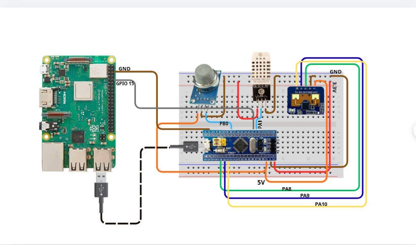

# Smart Indoor Environment Pipeline: Online Q-learning + MQTT

A single-process Python pipeline that runs on a Raspberry Pi. It reads sensor frames sent by an STM32 over UART, learns an alert policy online with tabular Q-learning, and publishes everything to an MQTT broker for a Node-RED dashboard.

It was developed as part of my undergraduate thesis, *Smart Indoor Environmental Monitoring and Control System with Reinforcement Learning*.



## How it works

```
 MQ-135 / DHT22 / LD2410C
          |
        STM32  --- UART (JSON lines, 115200 baud) --->  Raspberry Pi
                                                        sensor_pipeline_v2.py
                                                          1. Baseline phase
                                                          2. Online RL phase
                                                                |
                                                          MQTT broker (Mosquitto)
                                                                |
                                                            Node-RED dashboard
```

The script is one process and is the only owner of the serial port, which avoids the port conflict you get when a logger and a bridge both open `/dev/ttyUSB0`.

### Phase 1: Baseline (default 180 s)

The pipeline collects sensor readings and computes mean, standard deviation and percentiles per field. The result is saved to `checkpoint.json`, together with:

- MQ-135 warning threshold = mean + 1.5 std
- MQ-135 alert threshold = mean + 2.5 std

### Phase 2: Online reinforcement learning

| Item | Design |
|---|---|
| Algorithm | Tabular Q-learning, epsilon-greedy, batched Bellman updates (default every 50 frames) |
| State | (MQ-135 z-score bin, temperature z-score bin, humidity z-score bin, presence) = 7 x 6 x 6 x 2 = 504 states |
| Actions | `NORMAL`, `WARNING`, `ALERT` |
| Reward | Lookup table of (action, true level), from +2.0 for a correct alert to -3.0 for missing an alert |
| True level | Rule-based label from MQ-135 thresholds plus temperature and humidity deviation |
| Hyperparameters | alpha = 0.1, gamma = 0.9, epsilon 1.0 -> 0.05 (decay 0.9995 per frame) |

The Q-table is saved periodically as `.npy` and can be resumed with `--load-qtable`.

## Hardware

- Raspberry Pi 3
- STM32 (Blue Pill style board)
- MQ-135 gas sensor (analog output on PB0)
- DHT22 temperature and humidity sensor (data on PA1)
- LD2410C mmWave presence radar (UART on PA9 / PA10, see the diagram for PA8)

Pin labels follow `docs/wiring_diagram.png`. The STM32 firmware is not part of this repository.

## UART frame format

The STM32 sends one JSON object per line. Lines starting with `[` are treated as debug messages and printed. Only frames with `"type": "env"` are processed.

Fields read by the pipeline: `temp`, `hum`, `dht_ok`, `mq135_v`, `mq135_v_corr`, `cf`, `presence`, `state`, `move_cm`, `move_e`, `static_cm`, `static_e`, `detect_cm`, `ema_move`, `ema_stat`.

## MQTT topics

| Topic | Content | Dashboard tab |
|---|---|---|
| `sensors/environment` | temperature, humidity, MQ-135 | Tab 1 |
| `sensors/presence` | LD2410C radar data | Tab 2 |
| `sensors/rl` | action, reward, Q-values, epsilon | Tab 3 |
| `sensors/log` | full frame plus RL decision | Tab 3 |
| `sensors/logfile` | last 100 CSV rows, every 10 s | Tab 3 |
| `sensors/status` | heartbeat every 5 s | |

## Getting started

Requirements: Python 3.10 or newer, and an MQTT broker such as Mosquitto on `localhost:1883` (optional, see `--no-mqtt`).

```bash
git clone https://github.com/<your-username>/rl-mqtt-sensor-pipeline.git
cd rl-mqtt-sensor-pipeline

python3 -m venv .venv
source .venv/bin/activate
pip install -r requirements.txt

python3 sensor_pipeline_v2.py --port /dev/ttyUSB0
```

If the serial port is not accessible, add your user to the `dialout` group and log in again:

```bash
sudo usermod -aG dialout $USER
```

### Options

| Flag | Default | Description |
|---|---|---|
| `--port` | `/dev/ttyUSB0` | Serial port connected to the STM32 |
| `--baud` | `115200` | Baud rate |
| `--baseline-secs` | `180` | Baseline collection time |
| `--batch-size` | `50` | Frames per Q-learning batch update |
| `--log-dir` | `./sensor_logs` | Output folder |
| `--save-every` | `500` | Save the Q-table every N frames |
| `--load-qtable` | none | Resume from an existing `.npy` Q-table |
| `--no-mqtt` | off | Run without MQTT |
| `--new-log` | off | Write a new timestamped CSV instead of appending to `sensor_log.csv` |

Stop with `Ctrl+C`. The pending batch is applied, the Q-table and CSV are saved, and an offline status message is published.

## Output files (in `sensor_logs/`)

- `checkpoint.json`: baseline statistics and thresholds
- `sensor_log.csv`: per-frame log (frame, sensors, action, reward, true level, epsilon)
- `qtable_online_<timestamp>.npy`: learned Q-table

## Repository layout

```
.
├── sensor_pipeline_v2.py
├── requirements.txt
├── docs/
│   └── wiring_diagram.png
├── .gitignore
└── README.md
```
